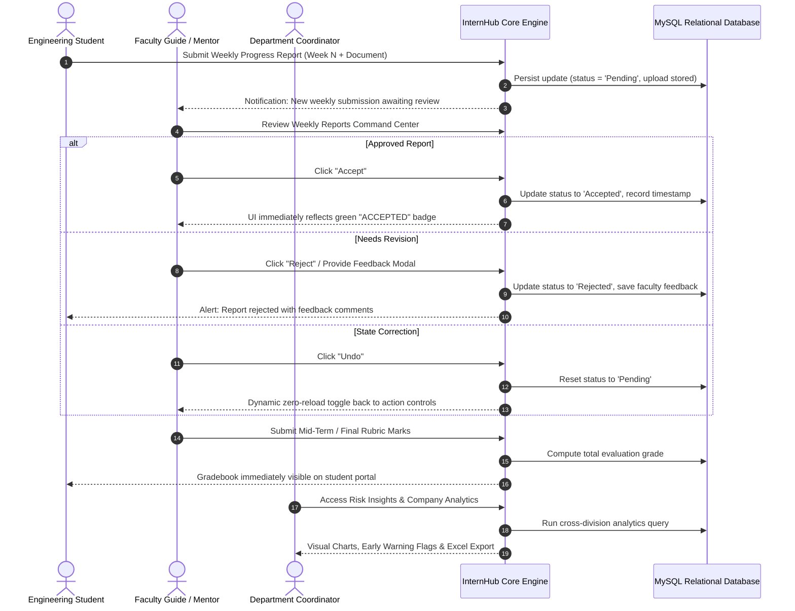
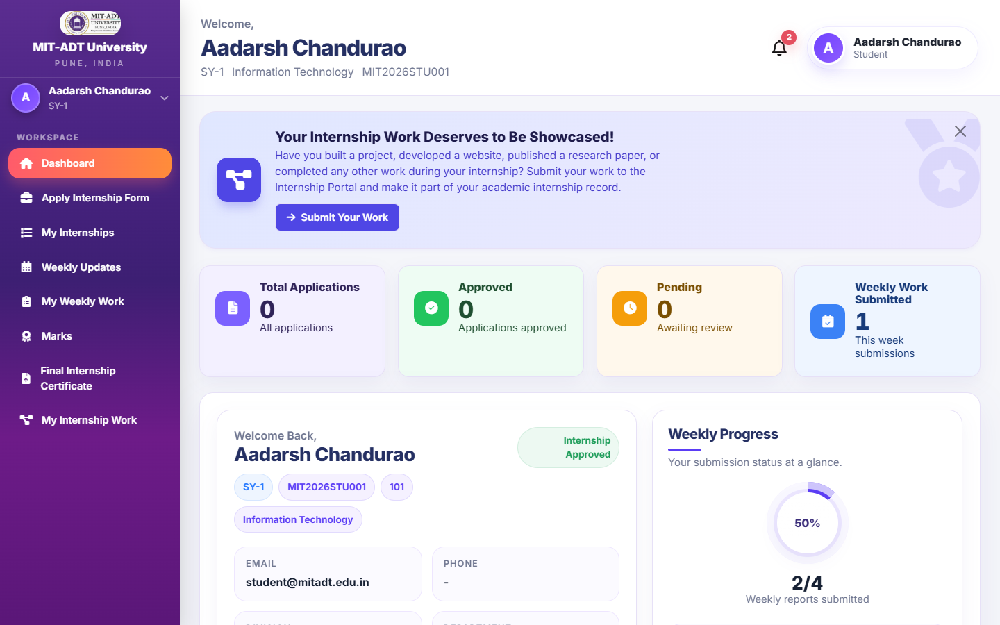
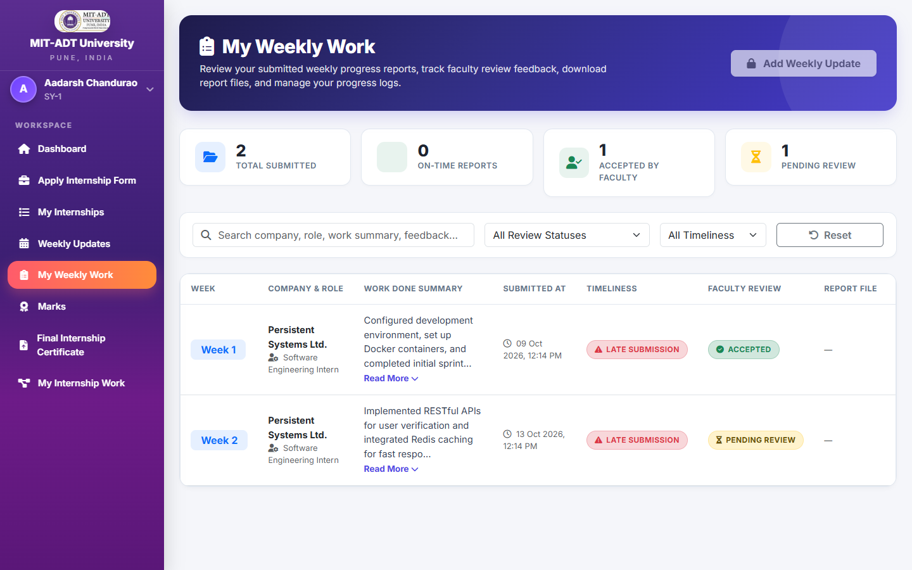
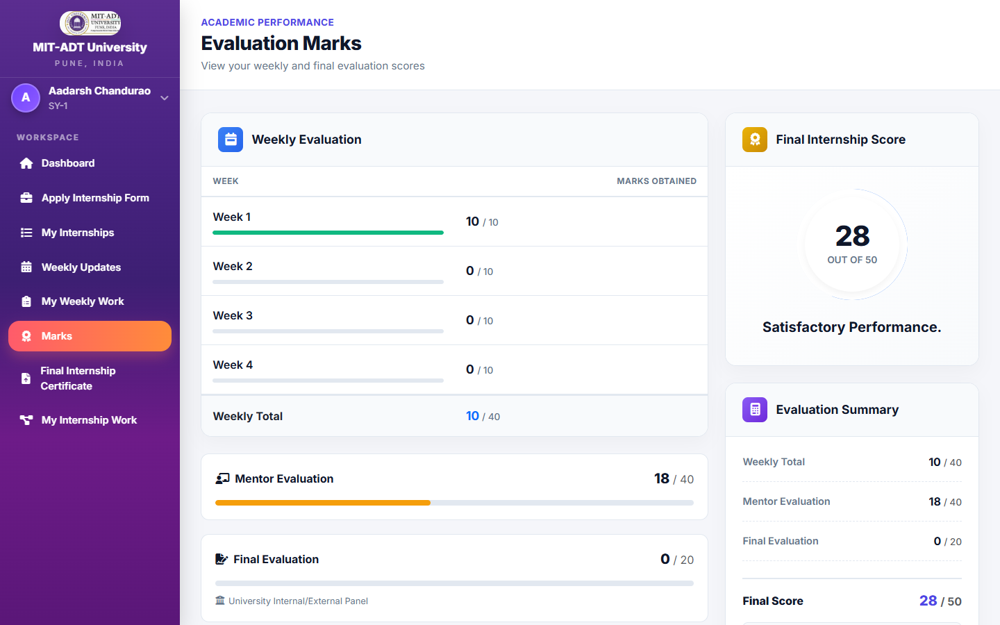
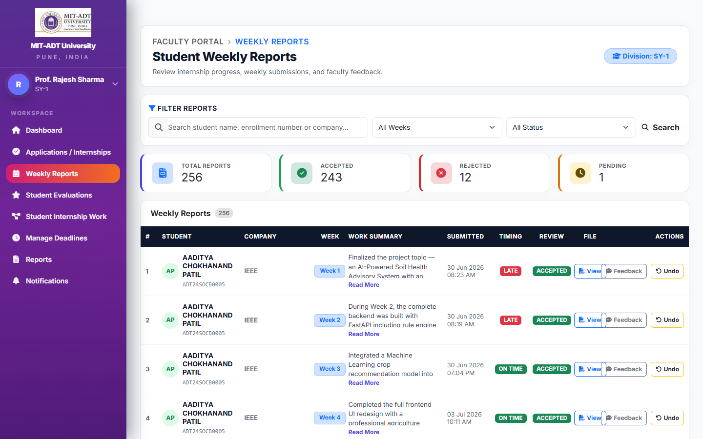
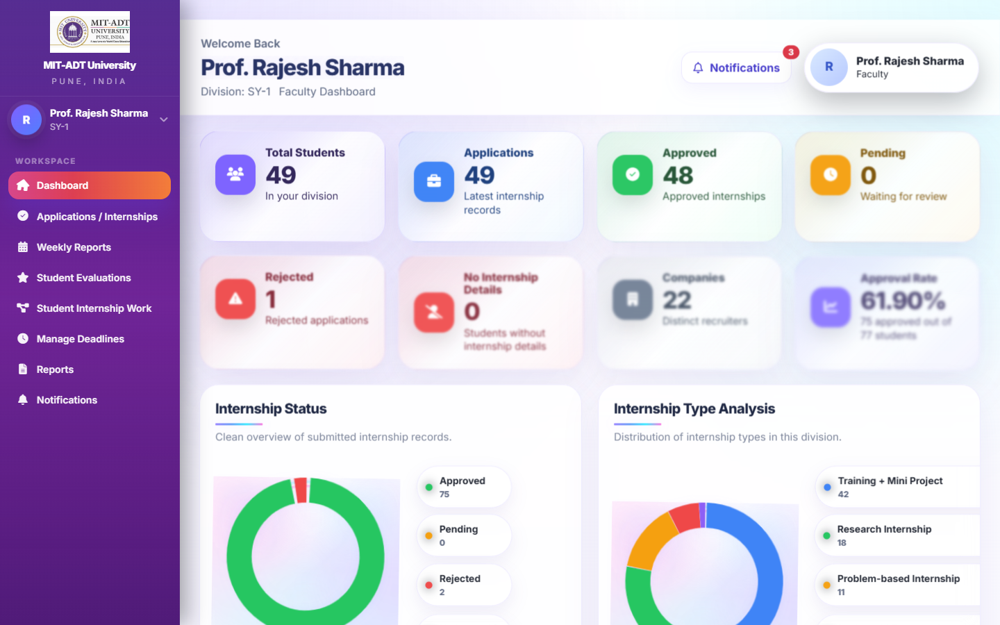
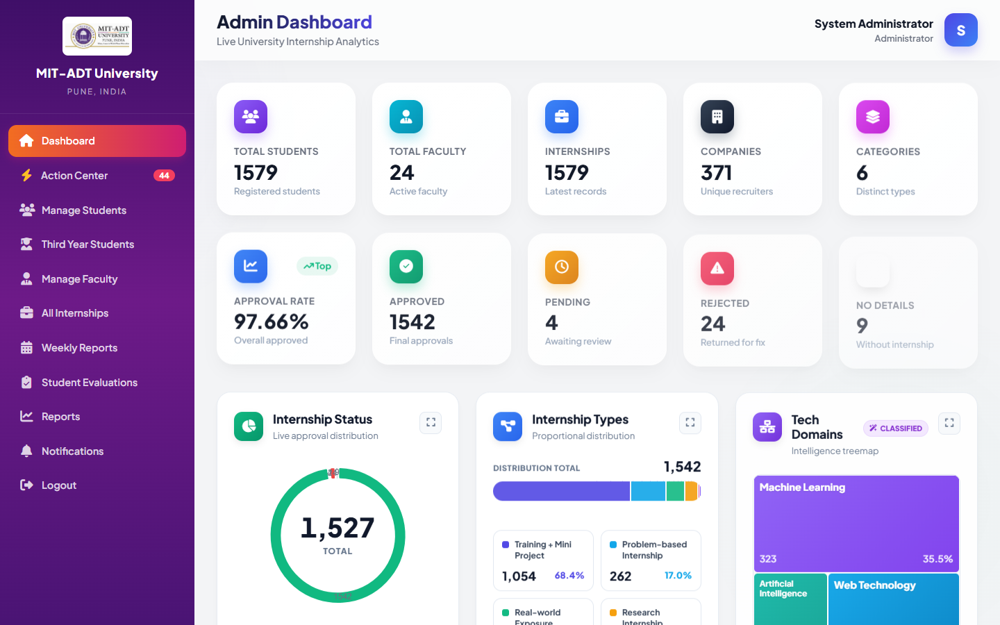
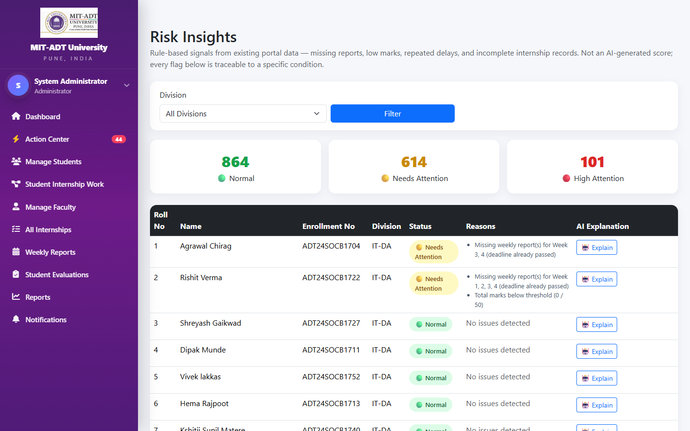
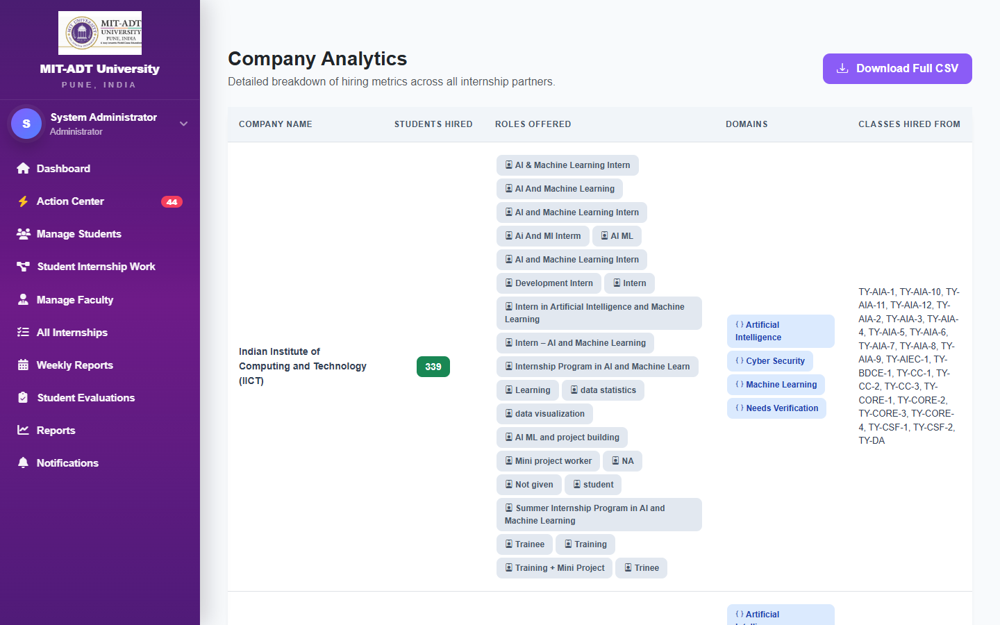

```mermaid
flowchart TD
    subgraph Client ["Client Presentation Layer"]
        A1["Student Portal UI"]
        A2["Faculty Guide UI"]
        A3["Admin Coordinator UI"]
    end

    subgraph Auth ["Authentication & Session Security"]
        B["Multi-Role Authentication Choke Point<br/>(login.php & Role-Based RBAC)"]
    end

    subgraph Controllers ["Application & Controller Layer"]
        C1["Student Services<br/>• Weekly Log Submissions<br/>• Document Uploads<br/>• Evaluation Viewer"]
        C2["Faculty Services<br/>• Report Verification (Accept/Reject/Undo)<br/>• Rubric Evaluation Engine<br/>• Risk Flagging & Feedback"]
        C3["Admin Services<br/>• Department Analytics & KPIs<br/>• Early Warning Risk Center<br/>• Company Domain Intelligence<br/>• Master Accreditation Exports"]
    end

    subgraph SharedLib ["Shared Business Logic & Utilities (lib/)"]
        D1["RiskAnalyzer Engine"]
        D2["AnalyticsDataProvider"]
        D3["Excel & PDF Exporters"]
        D4["Division & Batch Helpers"]
        D5["AI Diagnostic Service (AIService)"]
    end

    subgraph Storage ["Data & Storage Layer"]
        E1[("MySQL 8.0 Enterprise Relational DB<br/>• Normalized Schemas<br/>• Foreign Key Constraints<br/>• Composite Indexes")]
        E2["Secure File Store (uploads/)<br/>• Reports & Offer Letters<br/>• Sanitized Filenames<br/>• Extension Verification"]
    end

    Client --> Auth
    Auth --> Controllers
    Controllers --> SharedLib
    SharedLib --> Storage
```

<div align="center">

# 🎓 InternHub — MIT-ADT University
### Comprehensive Internship Management & Faculty Evaluation Portal
**Department of Computer Science & Engineering | School of Computing**

[](https://www.php.net/)
[](https://www.mysql.com/)
[](https://getbootstrap.com/)
[](https://www.chartjs.org/)
[](LICENSE)
[](#)

<p align="center">
  <a href="#-key-features">Key Features</a> •
  <a href="#-system-architecture">Architecture</a> •
  <a href="#-visual-showcase">Screenshots</a> •
  <a href="#-quick-start--installation">Quick Start</a> •
  <a href="#-demo-credentials">Demo Access</a> •
  <a href="#-security--privacy">Security</a> •
  <a href="#-project-team--developers">Team</a>
</p>

---

</div>

## 📌 Executive Overview

**InternHub** is an enterprise-grade university internship lifecycle management and academic evaluation platform developed for **MIT-ADT University, Pune**. Designed to streamline the coordination between undergraduate engineering students, faculty guides/mentors, and departmental internship coordinators, the platform automates the end-to-end internship workflow: from application tracking and weekly work progress logs to faculty rubric assessments, compliance risk detection, and multi-format accreditation reporting.

### Key Problems Solved
- **Elimination of Paper & Disorganized Spreadsheets**: Replaces manual weekly report submissions and email trails with a structured, auditable digital log.
- **Real-Time Faculty Oversight**: Enables mentors to review weekly student progress logs with single-click Accept, Reject, Undo, and targeted feedback modals with instant asynchronous UI state updates.
- **Predictive Risk Early Warning System**: Automatically flags students falling behind on weekly report deadlines, missing documentation, or scoring below evaluation thresholds.
- **Accreditation & Audit Readiness**: Generates one-click institutional gradebooks and compliance exports in Excel (`.xlsx`), CSV, and PDF formats.

---

## 🏗️ System Architecture

InternHub follows a modular **Role-Based Access Control (RBAC)** architecture separated into three specialized tiers:



---

## 🔄 Weekly Report & Evaluation Workflow



---

## 🌟 Key Features

### 👨‍🎓 1. Student Portal
- **Real-Time Progress Dashboard**: Visual progress gauge tracking approved weeks against semester internship requirements.
- **Weekly Progress Report Submission**: Structured submission form capturing work summary, skills utilized, learning outcomes, and supporting project artifacts (PDF/DOCX).
- **Asynchronous Update Log**: Live timeline displaying submission history, review statuses (`Accepted`, `Pending`, `Rejected`), and faculty feedback.
- **Academic Marks & Gradebook**: Instant visibility into mid-term and end-term evaluations, faculty rubric breakdowns, and performance feedback.
- **Showcase Portfolio**: Direct management of project deliverables, final reports, and verified completion certificates.
- **Account Security**: Profile photo management and secure credential updates.

### 👩‍🏫 2. Faculty Mentor Portal
- **Division & Batch Command Center**: Instant breakdown of student distributions across academic divisions and project batches.
- **Weekly Reports Verification Desk**: High-density review table with verified zero-overlap column architecture (`Review` | `File` | `Actions`).
  - **Instant State Synchronization**: Accept, Reject, and Undo operations trigger real-time DOM updates via asynchronous AJAX without full page reloads.
  - **Inline Feedback System**: Targeted modal allowing guides to provide constructive guidance on rejected submissions.
- **Rubric-Based Evaluation System**: Formal assessment module supporting multi-parameter grading (Technical Competence, Documentation, Attendance, Industry Mentor Feedback).
- **Early Warning Risk Detection**: Real-time identification of students lagging in submission deadlines or showing low attendance.
- **Accreditation Exports**: Export student evaluation records to Excel (`.xlsx`) and PDF with formatting optimized for academic boards.

### 🏛️ 3. Department Admin Portal
- **Centralized Institutional Analytics**: Executive dashboard with high-level KPIs: Total Enrolled, Active Placements, Total Weekly Submissions, and Guide Allocations.
- **Student Risk Insights Center**: Automated risk scoring engine analyzing student submission velocity, pending reviews, and missing reports with early intervention flags.
- **Company & Domain Intelligence**: Interactive Chart.js analytics breaking down student placements across industry sectors (Artificial Intelligence, Cloud Computing, Full-Stack Development, Cyber Security, Core Engineering).
- **Directory Management (CRUD)**: Complete lifecycle management for student cohorts, faculty assignments, and division allocations.
- **Institutional Compliance Exporting**: One-click generation of comprehensive departmental internship reports, student evaluations, and company databases in Excel and PDF formats.

---

## 📸 Visual Showcase

Captured from live, verified instances of InternHub using synthetic academic test datasets:

### Multi-Role Authentication Screen
> Seamless entry point routing students, faculty mentors, and coordinators into their respective security-isolated dashboards.


---

### Student Experience

| Student Dashboard & Progress Track | Weekly Submission Form |
| :---: | :---: |
|  |  |
| *Visual status tracker, announcements, and quick submission shortcuts* | *Structured form capturing weekly work summaries, competencies, and files* |

| Student Activity & Status Timeline | Student Marks & Gradebook |
| :---: | :---: |
|  |  |
| *Chronological timeline of weekly reports with instant status badges* | *Detailed rubric score breakdown and final evaluation grades* |

---

### Faculty Guide Command Center

| Faculty Weekly Reports Review Desk | Faculty Division & Batch Dashboard |
| :---: | :---: |
|  |  |
| *Verified zero-overlap actions table with Accept, Reject, Undo & Feedback* | *Cohort division breakdown, pending review counts, and quick actions* |

---

### Department Administrator Analytics & Oversight

| Centralized Department Dashboard | Student Risk Early Warning System |
| :---: | :---: |
|  |  |
| *Institution-wide KPIs, placement rates, and real-time activity stream* | *Algorithmic risk detection flagging at-risk students for early intervention* |

| Company Placement & Domain Analytics |
| :---: |
|  |
| *Interactive domain distribution and company hiring analytics powered by Chart.js* |

---

## 💻 Tech Stack & Dependencies

| Layer | Technology | Description |
| :--- | :--- | :--- |
| **Backend Runtime** | **PHP 8.2+** | Robust, modern server-side scripting utilizing typed properties and strict error handling |
| **Database** | **MySQL 8.0+** | Relational schema with normalized foreign keys, composite indexes, and utf8mb4 collation |
| **Frontend Framework** | **Bootstrap 5.3 & Tailwind Utilities** | Responsive, mobile-ready layout architecture with custom academic theming |
| **Client Scripting** | **Vanilla JS (ES6+) & Fetch API** | Asynchronous DOM manipulation, zero-lag status transitions, and modal management |
| **Data Visualization** | **Chart.js 4.x** | High-performance HTML5 canvas visualizations for company and cohort metrics |
| **Export Engines** | **PhpSpreadsheet & Native CSV** | Enterprise-grade Excel (`.xlsx`) generation and formatted CSV streaming |
| **Security Architecture** | **RBAC & Cryptographic Hashing** | Secure session isolation, parameterized queries, and BCrypt password encryption |

---

## 🚀 Quick Start & Installation

### System Prerequisites
- **Web Server**: Apache 2.4+ / Nginx / PHP Built-in Server
- **PHP**: `8.1` or higher (extensions: `pdo_mysql`, `mysqli`, `gd`, `zip`, `mbstring`, `fileinfo`)
- **Database**: MySQL `8.0` or MariaDB `10.4+`
- **Package Manager**: Composer (optional, for PhpSpreadsheet)

### 1. Clone the Repository
```bash
git clone https://github.com/Swaraj0160/Internship-Management-System.git
cd Internship-Management-System
```

### 2. Database Setup
Create an empty database and import the pristine, pre-configured schema with synthetic seed data:
```bash
mysql -u root -p -e "CREATE DATABASE IF NOT EXISTS internship_db CHARACTER SET utf8mb4 COLLATE utf8mb4_unicode_ci;"
mysql -u root -p internship_db < database/schema.sql
```

### 3. Configure Database Connection
Copy the sample configuration file and update it with your local credentials:
```bash
cp config.example.php config.php
```

Edit `config.php`:
```php
<?php
define('DB_HOST', 'localhost');
define('DB_USER', 'root');
define('DB_PASS', 'your_password');
define('DB_NAME', 'internship_db');

$conn = mysqli_connect(DB_HOST, DB_USER, DB_PASS, DB_NAME);
if (!$conn) {
    die("Database connection failed: " . mysqli_connect_error());
}
```

### 4. Ensure Directory Permissions
Make sure the upload directories are writable:
```bash
# Linux/macOS
chmod -R 775 uploads/

# Windows PowerShell
# Upload folders are created automatically and preserved via .gitkeep
```

### 5. Start Local Development Server
```bash
php -S 127.0.0.1:8000
```
Open your browser and navigate to:
```
http://127.0.0.1:8000/login.php
```

---

## 🔑 Demo Credentials

The database schema includes pre-seeded, synthetic accounts for immediate evaluation:

| Role | Email Address | Password | Accessible Portals |
| :--- | :--- | :--- | :--- |
| **Administrator** | `admin@mitadt.edu.in` | `Admin@123` | Institutional Dashboard, Risk Insights, Company Analytics, Directory CRUD, Exports |
| **Faculty Guide** | `faculty@mitadt.edu.in` | `Faculty@123` | Weekly Report Review Desk, Evaluation Rubrics, Division Batches, Student Feedback |
| **Student** | `student@mitadt.edu.in` | `Student@123` | Weekly Log Submissions, Document Uploads, Gradebook & Rubric Marks, Portfolio |

---

## 🌐 Live Interactive Demonstration

Experience InternHub live without local setup via our verified cloud tunnel:

🔗 **[Launch InternHub Live Demo](https://07e98cca50d8fc.lhr.life/login.php)**

> **Note**: The live demo instance runs in a sandboxed demonstration environment seeded exclusively with synthetic student identities.

---

## 🔒 Security, Privacy & Data Compliance

InternHub adheres to strict security standards suitable for higher-education university deployments:

- **100% Synthetic Data Guarantee**: No real student records, grades, personal phone numbers, or actual resumes are tracked in this repository. All schemas, screenshots, and test datasets utilize synthetic personas (`@mitadt.edu.in`).
- **Comprehensive Git Hygiene**: Sensitive files, production database dumps, credentials, and user uploads are strictly excluded via `.gitignore`:
  ```gitignore
  config.php
  .env*
  *.sql
  uploads/*
  !uploads/.gitkeep
  ```
- **SQL Injection Prevention**: Database interactions throughout core service layers use prepared statements and parameterized inputs via PDO and MySQLi.
- **Cross-Site Scripting (XSS) Mitigation**: All user-supplied inputs displayed in tables, timelines, and forms are sanitized through `htmlspecialchars()` with strict UTF-8 encoding.
- **Session Protection**: Administrative and faculty actions are gated behind strict session role verifications, preventing unauthorized URL traversal.

---

## 📂 Repository Structure

```
Internship-Management-System/
├── admin/                           # Centralized Administration Module
│   ├── action_center.php            # Coordinator action hub & pending approvals
│   ├── ai_explain_risk.php          # AI diagnostic summary for flagged students
│   ├── company_analytics.php        # Placement domain intelligence & charts
│   ├── dashboard.php                # Institutional KPI overview
│   ├── export_student_evaluations*  # PDF, CSV, Excel evaluation exporters
│   ├── manage_faculty.php           # Faculty directory CRUD
│   ├── manage_students.php          # Student cohort directory CRUD
│   ├── risk_insights.php            # Early warning risk detection center
│   └── includes/                    # Admin sidebar navigation & header components
├── faculty/                         # Faculty Mentor & Evaluator Module
│   ├── dashboard.php                # Faculty cohort overview
│   ├── manage_applications.php      # Student internship application vetting
│   ├── student_evaluations.php      # Rubric-based grading module
│   ├── undo_status.php              # Real-time state reversal controller
│   ├── view_updates.php             # Verified weekly reports review desk
│   └── includes/                    # Faculty navigation components
├── student/                         # Undergraduate Student Module
│   ├── add_update.php               # Weekly progress submission form
│   ├── dashboard.php                # Student dashboard & progress gauge
│   ├── marks.php                    # Published grades and rubric breakdown
│   ├── my_updates.php               # Submission history & faculty feedback
│   └── includes/                    # Student navigation components
├── lib/                             # Shared Business Logic & Service Engines
│   ├── AI/                          # AIService & configuration (safe degradations)
│   ├── AnalyticsDataProvider.php    # Aggregation queries for dashboard charts
│   ├── ExcelExporter.php            # Formatted spreadsheet generation
│   ├── PdfExporter.php              # Academic board PDF generation
│   └── RiskAnalyzer.php             # Algorithmic submission velocity scoring
├── database/                        # Database Assets
│   └── schema.sql                   # Pristine DDL schema & synthetic seed records
├── docs/                            # Project Documentation, Team & Screenshots
│   ├── screenshots/                 # High-resolution verified interface captures
│   └── team/                        # Project developer & contributor portraits
├── assets/                          # Static Frontend Assets (CSS, JS, Branding)
├── uploads/                         # Secure Local File Storage (.gitkeep preserved)
├── config.example.php               # Sanitized template configuration file
├── login.php                        # Unified multi-role authentication handler
├── logout.php                       # Session invalidation & teardown
└── .gitignore                       # Strict production exclusion rules
```

---

## 👥 Project Team & Developers

**InternHub** is conceptualized, designed, and engineered by **Team-Apex**:

<div align="center">

| Developer & Lead | Co-Developer & Contributor |
| :---: | :---: |
| <br/>### **Swaraj Ingale**<br/>**Team-Apex** | <br/>### **Wardhan Darekar**<br/>**Team-Apex** |
| [](https://github.com/Swaraj0160)<br/>Architecture, Core Backend Services, Dashboards & Evaluation Logic | Co-development, Frontend layout & Database coordination |

</div>

> **Official Portal Credit**: The login interface explicitly displays: **Designed and Developed by Team-Apex**.

---

## 🤝 Contributing

Contributions, bug reports, and enhancements are welcome:
1. Fork the project repository.
2. Create your feature branch (`git checkout -b feature/academic-rubric-enhancement`).
3. Commit your changes (`git commit -m 'feat: add custom rubric criterion'`).
4. Push to the branch (`git push origin feature/academic-rubric-enhancement`).
5. Open a Pull Request.

---

## 📄 License

This project is licensed under the **MIT License** — see the [LICENSE](LICENSE) file for full details.

---

<div align="center">
  <sub>Developed for the Department of Computer Science & Engineering, MIT-ADT University.</sub>
</div>
