# InternHub

<p align="center">
  <strong>MIT-ADT University — Comprehensive Internship Management & Faculty Evaluation Portal</strong><br>
  <em>Enterprise-grade university internship lifecycle platform, multi-role RBAC, predictive risk analytics, and real-time faculty rubric evaluation for engineering departments.</em>
</p>

<p align="center">
  
  
  
  
  
  
</p>

---

## Overview

**InternHub** is an enterprise-grade university internship lifecycle management and academic evaluation platform developed for the **Department of Computer Science & Engineering, MIT-ADT University, Pune**. Designed to streamline coordination between undergraduate engineering students, faculty guides/mentors, and departmental internship coordinators, the platform automates the end-to-end internship workflow: from application tracking and weekly work progress logs to faculty rubric assessments, predictive compliance risk detection, and multi-format accreditation reporting.

Unlike fragmented email submissions and uncoordinated spreadsheets, InternHub provides an auditable, role-isolated academic portal. Faculty mentors review submissions with instant zero-reload AJAX verification (`Accept`, `Reject`, `Undo`), coordinators monitor department-wide placement KPIs and early warning indicators, and students maintain continuous visibility over verified academic marks.

---

## The Academic Internship Challenge & The InternHub Solution

### The Challenge
- **Fragmented Submission Channels:** Engineering departments handling hundreds of concurrent internships face chaotic email trails, lost attachments, and unverified weekly progress claims.
- **Delayed Faculty Oversight:** Guides lack a consolidated review desk to monitor weekly technical deliverables, resulting in end-of-semester evaluation bottlenecks and delayed grading.
- **Undetected At-Risk Students:** Without proactive velocity tracking, students who fall behind on weekly deliverables or encounter workplace obstacles remain unnoticed until final viva examinations.
- **Labor-Intensive Accreditation Audits:** Compiling placement rosters, domain distributions, and grade sheets for NBA and NAAC accreditation reviews requires weeks of manual data cleaning.

### The InternHub Solution
- **Structured Weekly Submission Logs:** Mandatory weekly progress reporting capturing technical summaries, competencies exercised, and verified document deliverables.
- **Asynchronous Faculty Review Desk:** High-density review tables with instant zero-reload status transitions (`Accept`, `Reject`, `Undo`) and inline modal feedback for revisions.
- **Algorithmic Early Warning Risk Engine:** Automated submission velocity analysis (`lib/RiskAnalyzer.php`) that scores student activity and flags at-risk candidates for proactive guidance.
- **One-Click Institutional Compliance Exports:** Automated generation of department-wide gradebooks, company distribution analytics, and evaluation registers in Excel (`.xlsx`), CSV, and PDF.

---

## Application Screenshots

All screenshots below represent live, functioning InternHub modules running in desktop and mobile environments with synthetic academic test data:

### 1. Multi-Role Authentication Screen

*Unified authentication gateway routing Engineering Students, Faculty Mentors, and Department Coordinators into dedicated, security-isolated dashboard workspaces.*

---

### 2. Student Dashboard & Requirement Progress Tracker

*Student command center displaying live internship progress gauges, approved weekly milestone ratios, upcoming submission deadlines, and departmental announcements.*

---

### 3. Weekly Progress Submission Workspace

*Structured weekly reporting interface capturing detailed work summaries, software engineering competencies, deliverables achieved, and supporting PDF/DOCX documentation.*

---

### 4. Student Submission Activity & Faculty Feedback Timeline

*Chronological submission ledger rendering real-time verification badges (`Accepted`, `Pending`, `Rejected`) and granular feedback remarks from assigned faculty guides.*

---

### 5. Academic Marks & Evaluation Rubric Breakdown

*Published student gradebook breaking down rubric parameters, continuous assessment scores, mid-term evaluations, and final faculty commentary.*

---

### 6. Faculty Weekly Reports Review Desk

*High-density review workspace with verified zero-overlap action columns allowing guides to Accept, Reject, Undo, and dispatch inline feedback via asynchronous AJAX.*

---

### 7. Faculty Guide Division & Batch Command Center

*Mentor overview displaying assigned student cohort rosters, pending review queues, division distributions, and quick evaluation shortcuts.*

---

### 8. Department Administrator Executive KPI Dashboard

*Departmental executive command center highlighting total enrolled students, verified active industry placements, aggregate weekly submission rates, and faculty allocations.*

---

### 9. Algorithmic Student Risk Insights Center

*Early warning diagnostic engine analyzing submission velocity and deadline compliance, highlighting at-risk students for proactive faculty intervention.*

---

### 10. Industry Placement Domain Analytics

*Interactive sector intelligence powered by Chart.js displaying student distribution across Artificial Intelligence, Cloud Infrastructure, Full-Stack, and Core Engineering.*

---

## Core Implemented Capabilities

### 1. Multi-Role Role-Based Access Control (RBAC)
- Strict session-isolated authorization tiers for **Students**, **Faculty Mentors**, and **Department Administrators**.
- Hardened authentication choke point (`login.php`) ensuring users cannot traverse unauthorized endpoints.

### 2. Asynchronous Faculty Verification Desk
- Zero-reload AJAX status toggling: Guides can **Accept**, **Reject**, or **Undo** weekly logs with immediate DOM updates.
- Integrated modal feedback loop: Faculty can provide targeted, actionable revision comments directly on rejected submissions.

### 3. Algorithmic Risk Early Warning Engine
- Implemented in `lib/RiskAnalyzer.php`: Evaluates submission timestamps, weekly velocity, and evaluation thresholds.
- Categorizes student status into clear actionable risk tiers (`Normal`, `Attention Needed`, `Critical Risk`) to prevent semester-end surprises.

### 4. Interactive Company & Placement Intelligence
- Dynamic sector categorization and hiring analytics powered by Chart.js.
- Tracks industry distribution across AI/ML, Cloud Infrastructure, Cybersecurity, Full-Stack Engineering, and Data Science.

### 5. Multi-Format Institutional Compliance Exporting
- Integrated `lib/ExcelExporter.php` and `lib/PdfExporter.php` providing formatted gradebooks, student registers, and company reports ready for NAAC/NBA accreditation audits.

---

## Architecture & Workflow

```mermaid
flowchart TD
    subgraph Client ["Client Presentation Layer"]
        A1["Student Portal UI"]
        A2["Faculty Guide UI"]
        A3["Admin Coordinator UI"]
    end

    subgraph Auth ["Authentication & Session Security"]
        B["Multi-Role Authentication Choke Point<br/>(login.php & Role-Based RBAC)"]
    end

    subgraph Controllers ["Application & Controller Layer"]
        C1["Student Services<br/>• Weekly Log Submissions<br/>• Document Uploads<br/>• Evaluation Viewer"]
        C2["Faculty Services<br/>• Report Verification (Accept/Reject/Undo)<br/>• Rubric Evaluation Engine<br/>• Risk Flagging & Feedback"]
        C3["Admin Services<br/>• Department Analytics & KPIs<br/>• Early Warning Risk Center<br/>• Company Domain Intelligence<br/>• Master Accreditation Exports"]
    end

    subgraph SharedLib ["Shared Business Logic & Utilities (lib/)"]
        D1["RiskAnalyzer Engine"]
        D2["AnalyticsDataProvider"]
        D3["Excel & PDF Exporters"]
        D4["Division & Batch Helpers"]
        D5["AI Diagnostic Service (AIService)"]
    end

    subgraph Storage ["Data & Storage Layer"]
        E1[("MySQL 8.0 Enterprise Relational DB<br/>• Normalized Schemas<br/>• Foreign Key Constraints<br/>• Composite Indexes")]
        E2["Secure File Store (uploads/)<br/>• Reports & Offer Letters<br/>• Sanitized Filenames<br/>• Extension Verification"]
    end

    Client --> Auth
    Auth --> Controllers
    Controllers --> SharedLib
    SharedLib --> Storage
```



---

## Technology Stack

Verified directly from source code and package configurations:

| Component | Technology | Description |
|---|---|---|
| **Backend Runtime** | **PHP 8.2+** | Robust server-side scripting utilizing typed properties and strict error handling |
| **Database** | **MySQL 8.0+** | Relational schema with normalized foreign keys, composite indexes, and utf8mb4 collation |
| **Frontend Framework** | **Bootstrap 5.3 & Tailwind Utilities** | Responsive, mobile-ready layout architecture with custom academic styling |
| **Client Scripting** | **Vanilla JS (ES6+) & Fetch API** | Asynchronous DOM manipulation, zero-lag status transitions, and modal management |
| **Data Visualization** | **Chart.js 4.x** | High-performance HTML5 canvas visualizations for company and cohort metrics |
| **Export Engines** | **PhpSpreadsheet & Native CSV** | Enterprise-grade Excel (`.xlsx`) generation and formatted CSV streaming |
| **Security Architecture** | **RBAC & Cryptographic Hashing** | Secure session isolation, parameterized queries, and BCrypt password encryption |

---

## Repository & Directory Structure

```text
Internship-Management-System/
├── admin/                           # Centralized Administration Module
│   ├── action_center.php            # Coordinator action hub & pending approvals
│   ├── ai_explain_risk.php          # AI diagnostic summary for flagged students
│   ├── company_analytics.php        # Placement domain intelligence & charts
│   ├── dashboard.php                # Institutional KPI overview
│   ├── export_student_evaluations*  # PDF, CSV, Excel evaluation exporters
│   ├── manage_faculty.php           # Faculty directory CRUD
│   ├── manage_students.php          # Student cohort directory CRUD
│   ├── risk_insights.php            # Early warning risk detection center
│   └── includes/                    # Admin sidebar navigation & header components
├── faculty/                         # Faculty Mentor & Evaluator Module
│   ├── dashboard.php                # Faculty cohort overview
│   ├── manage_applications.php      # Student internship application vetting
│   ├── student_evaluations.php      # Rubric-based grading module
│   ├── undo_status.php              # Real-time state reversal controller
│   ├── view_updates.php             # Verified weekly reports review desk
│   └── includes/                    # Faculty navigation components
├── student/                         # Undergraduate Student Module
│   ├── add_update.php               # Weekly progress submission form
│   ├── dashboard.php                # Student dashboard & progress gauge
│   ├── marks.php                    # Published grades and rubric breakdown
│   ├── my_updates.php               # Submission history & faculty feedback
│   └── includes/                    # Student navigation components
├── lib/                             # Shared Business Logic & Service Engines
│   ├── AI/                          # AIService & configuration (safe degradations)
│   ├── AnalyticsDataProvider.php    # Aggregation queries for dashboard charts
│   ├── ExcelExporter.php            # Formatted spreadsheet generation
│   ├── PdfExporter.php              # Academic board PDF generation
│   └── RiskAnalyzer.php             # Algorithmic submission velocity scoring
├── database/                        # Database Assets
│   └── schema.sql                   # Pristine DDL schema & synthetic seed records
├── docs/                            # Project Documentation, Team & Screenshots
│   ├── screenshots/                 # High-resolution verified interface captures (10 images)
│   └── team/                        # Project developer & contributor portraits
├── assets/                          # Static Frontend Assets (CSS, JS, Branding)
├── uploads/                         # Secure Local File Storage (.gitkeep preserved)
├── config.example.php               # Sanitized template configuration file
├── login.php                        # Unified multi-role authentication handler
├── logout.php                       # Session invalidation & teardown
└── .gitignore                       # Strict production exclusion rules
```

---

## Quick Start & Installation

### System Prerequisites
- **Web Server**: Apache 2.4+ / Nginx / PHP Built-in Server
- **PHP**: `8.1` or higher (extensions: `pdo_mysql`, `mysqli`, `gd`, `zip`, `mbstring`, `fileinfo`)
- **Database**: MySQL `8.0` or MariaDB `10.4+`

### 1. Clone the Repository
```bash
git clone https://github.com/Swaraj0160/Internship-Management-System.git
cd Internship-Management-System
```

### 2. Database Setup
Create an empty database and import the pristine, pre-configured schema with synthetic seed data:
```bash
mysql -u root -p -e "CREATE DATABASE IF NOT EXISTS internship_db CHARACTER SET utf8mb4 COLLATE utf8mb4_unicode_ci;"
mysql -u root -p internship_db < database/schema.sql
```

### 3. Configure Database Connection
Copy the sample configuration file and update it with your local credentials:
```bash
cp config.example.php config.php
```

Edit `config.php`:
```php
<?php
define('DB_HOST', 'localhost');
define('DB_USER', 'root');
define('DB_PASS', 'your_password');
define('DB_NAME', 'internship_db');

$conn = mysqli_connect(DB_HOST, DB_USER, DB_PASS, DB_NAME);
if (!$conn) {
    die("Database connection failed: " . mysqli_connect_error());
}
```

### 4. Start Local Development Server
```bash
php -S 127.0.0.1:8000
```
Open your browser and navigate to:
```
http://127.0.0.1:8000/login.php
```

---

## Demo Credentials

The database schema includes pre-seeded, synthetic accounts for immediate evaluation:

| Role | Email Address | Password | Accessible Portals |
|---|---|---|---|
| **Administrator** | `admin@mitadt.edu.in` | `Admin@123` | Institutional Dashboard, Risk Insights, Company Analytics, Directory CRUD, Exports |
| **Faculty Guide** | `faculty@mitadt.edu.in` | `Faculty@123` | Weekly Report Review Desk, Evaluation Rubrics, Division Batches, Student Feedback |
| **Student** | `student@mitadt.edu.in` | `Student@123` | Weekly Log Submissions, Document Uploads, Gradebook & Rubric Marks, Portfolio |

---

## Security, Privacy & Data Compliance

InternHub adheres to strict security standards suitable for higher-education university deployments:

- **100% Synthetic Data Guarantee**: No real student records, grades, personal phone numbers, or actual resumes are tracked in this repository. All schemas, screenshots, and test datasets utilize synthetic personas (`@mitadt.edu.in`).
- **Comprehensive Git Hygiene**: Sensitive files, production database dumps, credentials, and user uploads are strictly excluded via `.gitignore`.
- **SQL Injection Prevention**: Database interactions throughout core service layers use prepared statements and parameterized inputs via PDO and MySQLi.
- **Cross-Site Scripting (XSS) Mitigation**: All user-supplied inputs displayed in tables, timelines, and forms are sanitized through `htmlspecialchars()` with strict UTF-8 encoding.
- **Session Protection**: Administrative and faculty actions are gated behind strict session role verifications, preventing unauthorized URL traversal.

---

## Project Team & Developers

**InternHub** is conceptualized, designed, and engineered by **Team-Apex**:

<div align="center">

| Developer & Lead | Co-Developer & Contributor |
| :---: | :---: |
| <br/>### **Swaraj Ingale**<br/>**Team-Apex** | <br/>### **Wardhan Darekar**<br/>**Team-Apex** |
| [](https://github.com/Swaraj0160)<br/>Architecture, Core Backend Services, Dashboards & Evaluation Logic | Co-development, Frontend layout & Database coordination |

</div>

> **Official Portal Credit**: The login interface explicitly displays: **Designed and Developed by Team-Apex**.

---

## License

This project is licensed under the **MIT License** — see the [LICENSE](LICENSE) file for details.
